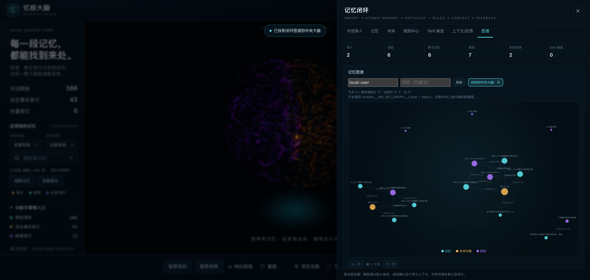

# 忆核大脑（Memory Brain）

> DeepSeek Harness 里的本地优先记忆闭环插件：把历史对话变成可追溯的原子记忆、
> 动态本体、可执行规则和可解释上下文，并用版本与反馈形成闭环。

[](LICENSE)



## 它解决什么问题

聊天记录能翻找，但不能可靠复用。忆核大脑把对话当**证据**，从里面拆出事实、偏好、约束、
决策、事件、待办和方法；再映射到动态本体与业务规则；需要时按用户/项目/任务/业务对象/
当前状态组装上下文，并把执行结果、用户纠正回写成新版本。

```
原始对话 → 原子记忆 → 动态本体 → 规则候选 → 确认/生效
      → 上下文（适用记忆 + 硬约束）→ 执行反馈 → 版本化更新
```

## 功能

- **对话导入**：JSON / Markdown / TXT / 粘贴；角色修正、归属、附件元数据、重复导入去重、增量追加。
- **持久后台队列**：导入/拆解/向量化任务写入 SQLite；重启/关页面不丢；支持取消与重试。
- **原子记忆**：模型建议默认候选；用户确认/纠正生成受保护版本；冲突保留；证据可回到原文。
- **动态本体**：类型/属性/关系/状态机；属性类型/枚举/单位校验；结构候选、版本快照、差异、回滚。
- **规则中心**：受限 JSON 条件（不使用 eval/SQL）；来源权威性与优先级；冲突检测与人工裁决。
- **上下文**：确定性加载硬约束；关键词/证据/范围/本体关联重排；可选向量召回；预算与 `why` 解释。
- **动作权限**：规则生效不等于执行授权；不自动调用外部业务动作。
- **反馈演进**：区分规则内容/范围、状态、未执行、工具失败；只生成候选版本，不自动训练/发布。
- **三维大脑**：Three.js 皮层可视化，可把闭环真实图谱投射到中央大脑。
- **单用户本地边界**：数据默认只在本机 SQLite；不伪装多租户安全。

## 快速开始

### 作为 DSH 插件

```bash
git clone https://github.com/wenxinzhang/dsh-memory-brain.git ~/dsh-workspace/memory-brain
cd ~/dsh-workspace/memory-brain
node tools/seed-sample.mjs --force     # 完全合成的开放样例，可跳过
```

在 DSH 中用 Plugin Manager 安装本地目录：

```
plugin_manager install_bundle target: ~/dsh-workspace/memory-brain
```

安装成功后打开 Web GUI → 任意会话 →「忆核大脑」→ 顶栏「闭环」。

### 独立开发 / 验收（不启动 DSH）

```bash
cd ~/dsh-workspace/memory-brain
node tools/seed-sample.mjs --force
node tools/loop-dev-server.mjs --port 18912
# 浏览器打开 http://127.0.0.1:18912/ → 顶栏「闭环」
```

## 数据与隐私

**代码开源，数据不开源。** 仓库与 npm 包只包含源码、文档和完全合成的样例数据：

- 不包含真实对话、`loop.db`、`payload.json`、`rules.json`、工作区语料、个人截图；
- 运行时数据只写本机 SQLite；
- 模型/embedding 端点必须显式配置，不默认把完整历史外传；
- 向量不可用时显式降级词法，不伪造结果；
- 敏感记忆默认不进入上下文；单用户运行边界，不是多租户安全系统。

详见 [DATA-POLICY.md](DATA-POLICY.md) 与 [软件说明](docs/software-description.md)。

## 架构

```
DSH host（lib/index.js）
 ├─ /memory-brain/* 静态页面 + 数据 API + 闭环 API
 ├─ lib/loop.js：SQLite（node:sqlite）
 │   ├─ 来源 / 消息 / 记忆 / 证据
 │   ├─ 本体定义 / 实例 / 状态历史 / 结构版本
 │   ├─ 规则 / 规则版本 / 冲突裁决 / 评估
 │   ├─ 持久任务（loop_jobs，租约 worker）
 │   ├─ embedding（可选）
 │   └─ 运行 / 反馈 / 审计
 └─ web/src：原生 ES Modules + Three.js 3D 大脑
```

不引入图数据库/向量数据库；对象、关系、版本和证据链都在 SQLite。

## 目录

```
memory-brain/
├─ lib/index.js          host 路由 + 静态服务
├─ lib/loop.js           记忆闭环运行时（导入/记忆/本体/规则/上下文/队列/向量）
├─ lib/rules.js          原有规则提炼接口（可选）
├─ lib/client.js         conversation.view tab
├─ web/                  页面、样式、3D 资源
├─ web/data/             运行时数据目录（真实数据不入库；仅 sample-payload）
├─ tests/loop.test.mjs   37 条行为测试
├─ tools/                样例数据、独立 dev server、浏览器 E2E
├─ docs/                 软件说明、契约、验收记录
├─ cordis.patch.yml      DSH bundle patch
└─ package.json          npm + DSH bundle 清单
```

## 配置

在 DSH profile 的 `cordis.patch.yml` 覆盖 `memory-brain` 行（整份替换）：

```yaml
- id: memory-brain
  config:
    prefix: /memory-brain
    root: ~/dsh-workspace/memory-brain/web
    payload: ~/dsh-workspace/memory-brain/web/data/sample-payload.json
    loopDb: ~/dsh-workspace/memory-brain/web/data/loop.db
    rulesEndpoint: http://127.0.0.1:8080/v1
    rulesModel: qwen3.8-flash-next
    loopEmbedEndpoint: http://127.0.0.1:8781/v1/embeddings
    loopEmbedModel: bge-m3
```

| 字段 | 默认 | 说明 |
|---|---|---|
| `prefix` | `/memory-brain` | 页面/API 前缀 |
| `root` | 包内 `web/` | 页面根目录 |
| `payload` | `<root>/data/payload.json` → `demo.json` → `sample-payload.json` | 3D 大脑数据包 |
| `loopDb` | `<root>/data/loop.db` | 闭环 SQLite |
| `rulesEndpoint` / `rulesModel` | 本机 OpenAI 兼容端点 | 抽取模型 |
| `rulesApiKeyEnv` | 空 | 模型 Key 环境变量名 |
| `loopEmbedEndpoint` / `loopEmbedModel` / `loopEmbedApiKeyEnv` | 本机 bge-m3 | 可选向量召回 |
| `loopWorkerIntervalMs` | 1200 | 后台任务轮询 |
| `loopContextChars` | 20000 | 上下文硬约束预算 |

## API 摘要

| 路径 | 说明 |
|---|---|
| `GET /memory-brain/api/health` | 页面数据健康检查 |
| `GET /memory-brain/api/all` | 3D 大脑数据包 |
| `/memory-brain/api/loop/*` | 闭环 API：导入/记忆/本体/规则/上下文/反馈/Skill/图谱/任务/向量 |
| `GET /memory-brain/api/loop/jobs` | 持久任务队列 |
| `GET /memory-brain/api/loop/ontology/versions` | 本体结构版本 |
| `GET /memory-brain/api/loop/embeddings/status` | 向量配置与索引状态 |

完整契约见 [docs/loop-api-v2.md](docs/loop-api-v2.md)（接口 v3 / schema v4）。

## 测试

```bash
node --test tests/loop.test.mjs

# 浏览器 E2E（独立 dev server，不污染演示库）
cp web/data/loop.db web/data/loop-verify.db
node tools/seed-v4-fixtures.mjs web/data/loop-verify.db
node tools/loop-dev-server.mjs --port 18912 --db web/data/loop-verify.db
node tools/loop-e2e.mjs http://127.0.0.1:18912/ /tmp/loop-shots
node tools/loop-e2e-manage.mjs http://127.0.0.1:18912/ /tmp/loop-manage
```

当前基线：37 个行为测试；53 + 39 项浏览器 E2E。详见
[verification-v3.md](docs/verification-v3.md)。

## 文档

- [软件说明](docs/software-description.md)
- [记忆闭环说明](docs/memory-loop.md)
- [API 契约](docs/loop-api-v2.md)
- [验收记录 v3](docs/verification-v3.md)
- [数据政策](DATA-POLICY.md)

## 许可证

代码 MIT。第三方前端资源遵循各自许可证（见 `web/assets/*LICENSE*` 与 [THIRD-PARTY-NOTICES.md](THIRD-PARTY-NOTICES.md)）。
数据不在开源许可范围内，详见 [DATA-POLICY.md](DATA-POLICY.md)。
